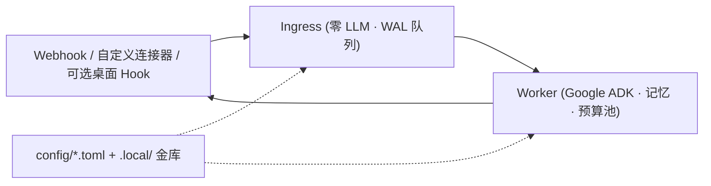

# EchoLoom

> 渠道无关、防丢队列与情景记忆驱动的 AI Agent 运行时（基于 Google ADK）  
> 发行包名 `echoloom` · 导入模块 `wechat_agent` · License: [0BSD](LICENSE)

## 核心特点

- **多源可插拔**：默认自带零桌面依赖的通用 HTTP [`WebhookConnector`](src/wechat_agent/connectors/webhook.py)；Telegram / 飞书 / Discord / 自定义 Hook 均以统一插件挂载。
- **配置全外部化与 `.local/` 隔离**：模型费率（[`config/models.toml`](config/models.toml)）、压缩/换新会话阈值（[`config/agent_profiles.toml`](config/agent_profiles.toml)）与个人私有资产（`.local/`）完全独立加载。
- **防丢双进程（Scheme A）**：零 LLM 依赖的 `Ingress` 写入 SQLite WAL 队列，独立 `Worker` 原子认领执行，重启不丢消息。
- **官方 Token 计数与微美元预算**：事前调用 Gemini / OpenAI 官方计数接口并带 LRU 缓存，事后按真实 `usage` 整数结算。



## 3 步快速启动（纯 Webhook，无需微信）

### 1. 安装（Python 3.12+）

```powershell
python -m venv .venv
.\.venv\Scripts\python.exe -m pip install -e ".[dev]"
```

### 2. 初始化 `.local/` 并配置 API Key

```powershell
# 一键生成 .local/{runtime,sources,agent_profiles}.toml 与 .local/prompts/（不覆盖已有文件）
.\.venv\Scripts\python.exe -m wechat_agent.local_config init

# 存入模型 Key（或改用环境变量 GEMINI_API_KEY / OPENAI_API_KEY；按所选模型按需配置）
.\.venv\Scripts\python.exe -m wechat_agent.credentials store --service model
.\.venv\Scripts\python.exe -m wechat_agent.credentials store --service openai
```

### 3. 启动并发送一条测试消息

```powershell
# 启动服务（Linux/macOS 可直接分终端跑 scripts/run-ingress.py --run 与 scripts/run-group-pilot.py --run --role worker）
.\scripts\start-services.ps1

# 通过 Webhook 投递测试事件
.\.venv\Scripts\python.exe scripts\send-event.py `
  --source webhook --conversation room:general --sender user:alice --text "你好 EchoLoom"
```

常用工具：`echoloom-vault status`（查金库状态）、`echoloom-vault audit`（提交前扫描敏感信息）、`echoloom-dashboard`（只读观察台，默认 `:8767`）、`pytest -q`（自动隔离 `.local/` 的离线测试）。

## 接入自定义信息源 / 更换 Hook

在 `.local/sources.toml` 注册外部连接器即可生效，无需修改核心代码（完整协议与字段见 [`docs/connectors-and-sources.md`](docs/connectors-and-sources.md)）：

```toml
[sources.my_channel]
enabled = true
factory = "my_package.connector:MySourceConnector"
channel = "my_source"
account_id = "bot_local"
default_conversation_id = "room:main"
```

## 配置与文档索引

| 主题 | 文件 |
|---|---|
| 模型目录、费率与辅助角色模型 | [`config/models.toml`](config/models.toml)（支持 `.local/models.toml` 覆盖） |
| 档案绑定、预算池、压缩与换新会话上限 | [`config/agent_profiles.toml`](config/agent_profiles.toml) · [`docs/agent-profile-config.md`](docs/agent-profile-config.md) |
| 服务端口、时区、提示词与 `.local/` 覆盖 | [`config/runtime.example.toml`](config/runtime.example.toml) · [`prompts/README.md`](prompts/README.md) |
| 多源连接器、Webhook 协议与 Hook 替换 | [`config/sources.example.toml`](config/sources.example.toml) · [`docs/connectors-and-sources.md`](docs/connectors-and-sources.md) |
| WeChat PC 4.1.10.27 Hook 一键构建（可选） | [`hooks/wechat-4.1.10.27/README.md`](hooks/wechat-4.1.10.27/README.md) · [`build-wechat-hook.ps1`](hooks/wechat-4.1.10.27/build-wechat-hook.ps1) |
| 系统架构与凭据安全 | [`docs/architecture/current-architecture.md`](docs/architecture/current-architecture.md) · [`docs/security/credentials.md`](docs/security/credentials.md) |

## 第三方 Hook 边界与免责声明

本开源仓库仅提供纯 HTTP/JSON 连接器契约、最小补丁与本地一键构建脚本，**不包含、不分发任何微信安装包、预编译 DLL 或第三方 Hook 源码**。如需复现 WeChat PC `4.1.10.27` 接入方案，请按 [`hooks/wechat-4.1.10.27/README.md`](hooks/wechat-4.1.10.27/README.md) 在本机自行拉取上游仓库编译，并严格遵守对应上游声明与平台条款。

本项目基于最宽松的 [0BSD License](LICENSE) 开源（无需署名、允许任意使用与修改）。
