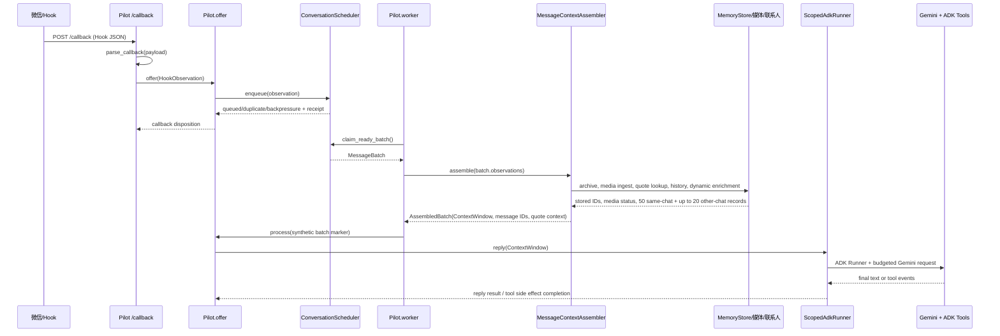
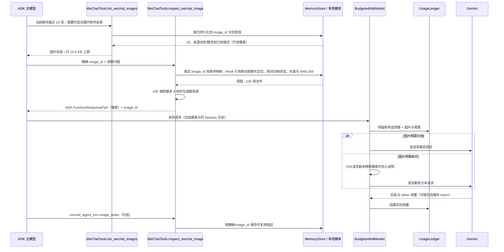
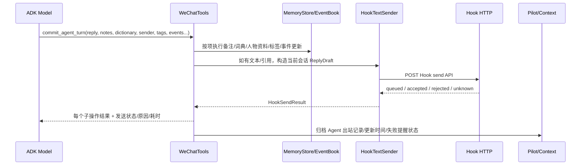
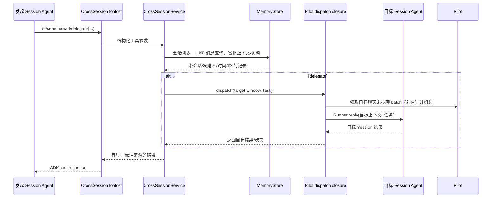
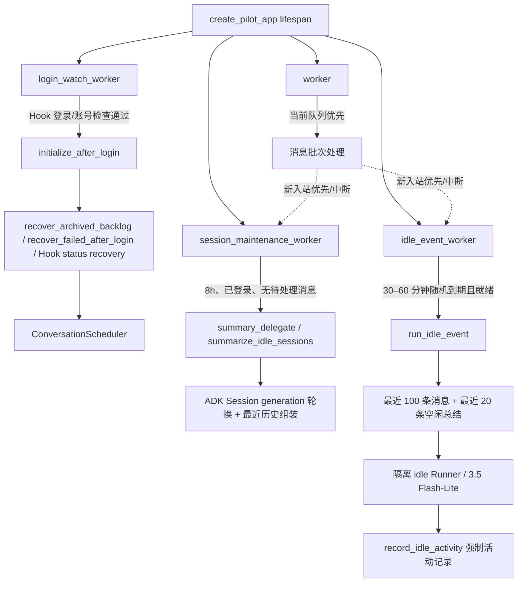
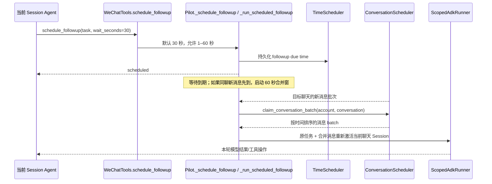

# 主要方法调用拓扑

方法级概览。标识符、函数和返回值以源码为准；该图描述静态调用顺序，不代表某次运行一定完成或对端一定收到。

## A. 真实入站消息到 Agent



`ConversationScheduler` 持久化的是 Pilot 入站 receipt/batch。`MessageContextAssembler` 同时写消息归档并组装模型上下文；当批次处理正常完成后，Pilot 更新模型已看状态。失败/超时会交给现有重试状态处理，不应把 Hook 回调 HTTP 成功等同于模型完成。

### 按需读图（同一主模型）



像素会保留在 ADK Session Event 中，以便后续请求继续使用；预算器对副本作的剥离不修改存档 Event。图片描述是模型读图后的可选数据更新，不再由工具里的第二个模型生成。

## B. 模型发消息与批量更新



`commit_agent_turn` 是合并写操作工具：合法项目可成功，单项错误按项返回；`queued` 表示 Hook 排队，不等于微信对端确认。模型也可能直接返回普通文本，由 Pilot 的普通回复处理路径发送并归档。

## C. 跨聊天检索和委托



会话搜索的“读到其他聊天”与“向当前聊天转述”是两个决定。目标 Session 的工具上下文路由到目标聊天；实际微信发送仍是该目标 Session 自己调用发送工具的副作用。

## D. 启动恢复、Session 维护和空闲活动



`TimeScheduler` 保存任务时点和状态，Pilot worker 执行到期处理。会话总结不在未登录或消息待处理时运行；空闲任务是独立 Session，并要求写入活动记录。

## E. Agent 主动等待与同聊新消息合并



按当前实现，等待期间新消息不直接取消任务；在首条新消息后给该聊天 60 秒聚合，再合并唤醒。返回字段明确为 `cancel_on_new_message=false`。工具方法 docstring 仍称新消息会取消，代码与注释不一致，维护时应以 `_run_scheduled_followup()` 和实际返回对象为准。

## F. 消息处理失败与发送失败

```text
模型调用前预算不足 ──> 不调用模型，批次记为预算失败/状态可见
模型异常/超时       ──> Pilot 释放或重试当前 batch（有上限/退避）
发送明确拒绝        ──> 原因返回工具/当前处理逻辑，按已配置上限停止
发送 unknown        ──> 标记结果未知；避免把未知当成未发送而无限重发
发送 queued         ──> 记录 Hook 已排队；不宣称对端送达
连续发送终止失败    ──> tool-receipts.sqlite3 写待办提醒；下一条真实消息再给 Agent
```

具体状态枚举和次数上限见 `pilot.py`、`wechat_tools.py`、`hook_outbound.py`；此处只列责任流向，不复述其状态机细节。
