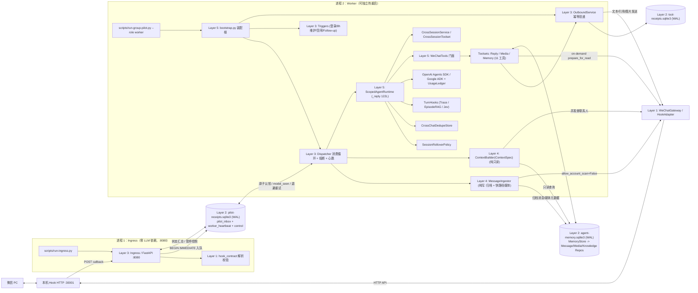

# 当前五层分层架构图

> **架构基线**：五层架构重构完成态（分支 `feat/openai-agent-runtime`，最新代码提交 `fa077cd`，全仓测试 `421 passed, 0 failed, 0 skipped`，85/85 模块导入干净）。  
> **关联设计文档**：[`docs/refactor-5-layer-plan.md`](../refactor-5-layer-plan.md) · [`docs/refactor-progress.md`](../refactor-progress.md)  
> 本文描述当前仓库真实模块边界、Scheme A 双进程拓扑与持久数据所有权；Hook 进程存活、模型配置与对端送达状态需在运行时单独核对。

---

## 1. 五层架构与 Scheme A 双进程主链路

生产推荐采用 **Scheme A 读写分离双进程拓扑**：极薄零 LLM 依赖的 `Ingress` 进程独占 `127.0.0.1:8080` 接收入站回调并直接写入 WAL 模式 `data/pilot-receipts.sqlite3`；独立 `Worker` 进程通过 `BEGIN IMMEDIATE` 原子认领队列并执行上下文构建、模型推理与 Hook 出站投递。重启 Worker（`scripts/live.ps1 -Action restart-worker`）不会中断 `:8080` 接收入站消息。测试与单进程调试仍可通过 `Pilot` 门面（`--role all` / `create_pilot_app`）复用同一套核心组件。

---

## 2. 五层模块清单与职责边界

依赖方向严格自上而下（Layer 5 → Layer 4 → Layer 3 → Layer 2 → Layer 1），所有 Layer 3/4/5 业务模块严禁硬编码 Hook HTTP 端点路径（由 `tests/test_wechat_gateway.py::test_business_modules_do_not_embed_hook_endpoints` 持续守卫）。

| 层级 | 核心模块（当前行数） | 职责与核心不变量 |
|---|---|---|
| **Layer 1：Hook 接入与媒体协议层** | `wechat_gateway.py` (135L) `adapters/hook.py` (182L) `adapters/hook_media.py` (423L) `media.py` (455L) `adapters/recording.py` · `hook_contract.py` · `hook_outbound.py` | 唯一允许封装本机 Hook HTTP `:30001` 协议的层（文本/引用/图片发送、联系人查询、图片/语音获取与本地归档）。`allow_account_scan` 控制是否触发全账号 `Decode_Pic` 扫描：入站快路径固定 `False`（0 次跨聊天解码），模型主动读图 `prepare_for_read()` 才按需开启 `True`。 |
| **Layer 2：数据存储与领域仓储层** | `memory_store.py` (1,354L 门面) `repos/message_repo.py` (780L) `repos/media_repo.py` (971L) `repos/knowledge_repo.py` (815L) `conversation_scheduler.py` (766L) `time_scheduler.py` · `event_book.py` · `episode_memory.py` · `storage.py` · `usage.py` | 零 Schema 迁移风险地管理全部生产 SQLite。`MemoryStore` 内部拆分为 `MessageRepo` / `MediaRepo` / `KnowledgeRepo` 三仓储共享 `(db, _lock, transaction)`；`ConversationScheduler` 对 `pilot-receipts.sqlite3` 启用 WAL + `BEGIN IMMEDIATE` + `worker_heartbeat`，实现**单一真源无死信状态机**：仅 Agent 正常完成才标 `model_seen`，瞬态错误/超时退回 `pending`（封顶 300s 指数退避），日预算耗尽退回 `pending` 且 `next_attempt_at` 对齐北京时间次日 `00:00:05`（不扣 `attempts`）。 |
| **Layer 3：消息调度与出站投递层** | `ingress.py` (411L) `dispatcher.py` (1,059L) `outbound.py` (1,092L) `triggers.py` (920L) `turn_scope.py` (102L) `pilot.py` (434L 同进程门面) | 将原巨石 `Pilot` 拆为四组件：`Ingress`（HTTP `:8080` 入队与 `/status` 21 键聚合）、`Dispatcher`（批次消费、跨会话调度、Provider 熔断、后台心跳）、`OutboundService`（独占 `tool-receipts.sqlite3` WAL 幂等认领、多气泡节奏、1+3 重试与自动纠错）、`Triggers`（登录监听、8h 维护防空转 + `TimeScheduler.prune`、空闲活动、Follow-up 复用 `OutboundService`）。`Pilot` 退居兼容门面。 |
| **Layer 4：统一上下文组装层** | `message_ingestor.py` (290L) `context_builder.py` (693L) `context_assembler.py` (97L 门面) `context.py` (898L) `cross_session.py` (999L) | **严格读写分离**：`MessageIngestor` 负责入站写（`voice_hex` 脱敏、归档、`allow_account_scan=False` 快路径媒体入库，默认跳过同步历史缩略图升级）；`ContextBuilder.build(ContextSpec)` 为 **100% 纯只读**（经 `PRAGMA query_only = ON` 单测验证），通过 `for_chat` / `for_followup` / `for_cross_session` / `for_idle` 4 套预设统一全部上下文构建，含并行 `asyncio.gather` 查联系人、`apply_sender_remarks` 与 `priority_sender_profiles`。 |
| **Layer 5：Agent 运行时、工具集与装配根** | `session_runtime.py` (990L, `_reply` 122L) `session_rollover.py` (1,028L) `cross_chat_dedupe.py` (139L) `turn_hooks.py` (517L) `wechat_tools.py` (449L 门面) `toolsets/reply.py` (286L) `toolsets/media.py` (927L) `toolsets/memory.py` (503L) `trace_dashboard.py` (354L) `bootstrap.py` (1,358L) `ports.py` (7L, 仅 `Clock`) | `ScopedAgentRuntime._reply` 经 `SessionRolloverPolicy`（8h/字节/Token 轮换与两阶段安全降级）、`CrossChatDedupeStore`（失败不标已看）与 `TurnHook` 扩展点（`TraceTurnHook` 原子安全脱敏、`EpisodeRagTurnHook`、`JevStrategyTurnHook` 并发前置执行）瘦身至 122 行。`WeChatTools` 拆分为 `ReplyToolset`(2) / `MediaToolset`(6) / `MemoryToolset`(3) 共 11 个注册工具并声明静态 `TOOL_NAMES`（消除 `trace_dashboard.py` `object.__new__` hack）。`bootstrap.py` 承担全部生产依赖装配且顶层零 LLM SDK 导入，支撑超薄 CLI 入口。 |

---

## 3. 运行模式与入口脚本

| 模式 | 入口与参数 | 进程与导入特征 | 典型用途 |
|---|---|---|---|
| **Scheme A：独立 Ingress** | `scripts/run-ingress.py --run` (36L) 或 `scripts/run-group-pilot.py --run --role ingress` | 独占 `127.0.0.1:8080`，**零 LLM SDK 导入**（不加载 `openai`/`agents`/`google.adk`/`google.genai`/`EpisodeMemory`/`ScopedAgentRuntime`），仅写 WAL `pilot-receipts.sqlite3`。 | 生产常驻回调接收面，保证 Worker 重启或升级期间零丢消息。 |
| **Scheme A：独立 Worker** | `scripts/run-group-pilot.py --run --role worker` (53L) | 不监听 `:8080`，经 `bootstrap.run_worker_loop()` 启动 `Dispatcher`、`Triggers` 与 Agent 运行时，定期刷新 `worker_heartbeat`。 | 生产推理与发送执行面；可通过 `scripts/live.ps1 -Action restart-worker` 独立重启，且被 `scripts/watch-services.py` 优先按 worker-only 自愈。 |
| **同进程兼容模式** | `scripts/run-group-pilot.py --run --role all`（默认） 或测试中的 `create_pilot_app(pilot)` | 单进程同时挂载 `Ingress` `:8080` 与 `Dispatcher`/`Triggers`。 | 本地联调、回归测试与向后兼容运行。 |
| **运维编排与看门狗** | `scripts/live.ps1` (315L, UTF-8 BOM) `scripts/start-services.ps1` (333L, UTF-8 BOM) `scripts/watch-services.py` (409L) | `live.ps1` 支持 `status / start / stop / pause / resume / restart-worker`；`pause`/`resume` 继续兼容 `pilot-receipts.sqlite3` `control` 表。 | 生产日常启停、状态巡检、只重启 Worker 与自动看护。 |
| **Trace 观测面板** | `src/wechat_agent/trace_dashboard.py` (354L) | 只读检索 `agent-memory.sqlite3`、trace JSONL 与工具静态 `TOOL_NAMES`。 | 运行链路追踪、工具清单与上下文审计。 |

> **注**：仓库中早期 M1/M2 原型源码（`inbound_queue.py`、`outbox.py`、`service.py`、`replay.py`、`app.py`、`commands*.py`、`hook_ingress.py`、`wechatpyapi_adapter.py`、`frameworks/openai_web.py`、`frameworks/adk_history.py`、`event_book_tools.py`、`demo.py`）已全部移除；`scripts/dev.ps1` 与 `scripts/start.ps1` 仍为未清理的 3 行早期 M1 mock 启动脚本，不再作为生产入口。

---

## 4. 持久数据与 SQLite 所有权

全部既有生产 SQLite 路径与既有表 Schema 保持零迁移兼容；跨进程共享库（`pilot-receipts.sqlite3`、`tool-receipts.sqlite3`、`agent-memory.sqlite3`）均工作在 WAL + `busy_timeout=5000` 模式下：

| 路径 | 写入所有者（只读外部读者） | 核心表与用途 |
|---|---|---|
| `data/pilot-receipts.sqlite3` | `ConversationScheduler`（Ingress 入队 / Worker 认领与心跳；`live.ps1` 写 `control`、`watch-services.py` 读 `pilot_inbox`） | `pilot_inbox`（入站调度单一真源）、`worker_heartbeat`（Worker 存活与积压状态）、`control`（pause/resume）、`attempts`（仅作终态审计兼容，不再拦截入站重放）。 |
| `data/agent-memory.sqlite3` | `MemoryStore`（`MessageRepo`/`MediaRepo`/`KnowledgeRepo`）、`TimeScheduler`、`EventBook`、`CrossSessionService`（`trace_dashboard.py`、`watch-services.py`、`scripts/image-library.py` 只读） | 24 张业务表：消息原文/JEV 标签、媒体与图片库修订/音频转写、备注/词典/用户事实/发送人资料与标签/审计、`time_jobs`（已修复空转热写并带自动 prune）、事件簿与空闲活动。 |
| `data/tool-receipts.sqlite3` | `OutboundService`（`outbound.py`） | 工具发送幂等回执、跨 rebatch 去重、失败计数与提醒状态（4 张原表结构不变）。 |
| `data/openai-sessions.sqlite3` `data/openai-sessions-routing.sqlite3` | OpenAI Agents SDK 运行时 / `SessionRolloverPolicy` / `CrossChatDedupeStore` | OpenAI 会话事件、generation 路由（`active_sessions`）与跨聊天去重（`session_other_message_seen`）。 |
| `data/live-sessions.sqlite3` `data/live-sessions-routing.sqlite3` | Google ADK `DatabaseSessionService` / `SessionRolloverPolicy` / `CrossChatDedupeStore` | Google ADK 会话事件、generation 路由与跨聊天去重。 |
| `data/pilot-usage.sqlite3` | `Repository`（`storage.py`） / `UsageLedger`（`usage.py`） | 模型调用预算预留、实际结算与北京时间（UTC+8 `Asia/Shanghai`）自然日重置记录；具体模型与限额由 `config/agent_profiles.toml` 与 `agent_profiles.py` 加载。 |
| `data/episode-memory.sqlite3` | `EpisodeMemory`（经 `EpisodeRagTurnHook` 召回与入队） | 事件级长期记忆与检索索引。 |
| `data/conversation-model-overrides.sqlite3` | `ConversationModelOverrideStore` | 按会话动态覆盖模型配置。 |
| `data/tool-controls.sqlite3` / `data/hook-event-outbox.sqlite3` | 运行时按需创建 | 工具控制开关与 Hook 事件外发日志。 |
| `data/received-images/` · `data/received-audio/` | `WeChatImageIngestor` / `WeChatVoiceIngestor` / `MediaRepo` | 入站归档图片/语音及生成图像资产。 |

---

## 5. 外部接口与本机端口

- **Hook 状态与发送 API**：`127.0.0.1:30001`（由外部微信 Hook 进程监听，仓库内仅 Layer 1 访问）。
- **Ingress 回调与健康状态接口**：`127.0.0.1:8080`（`POST /callback`、`GET /status`、`GET /health`，Scheme A 下由独立 `run-ingress.py` 进程监听）。
- 具体监听与健康状态以 `powershell -File scripts/live.ps1 -Action status` 实时查询结果为准。
